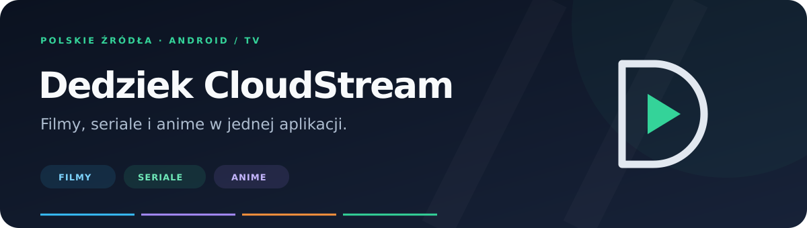

<p align="center">
  
</p>

<p align="center">
  <a href="https://github.com/dedziek/dedziek-cloudstream/actions/workflows/build.yml"></a>
  &nbsp; <a href="#instalacja">Instalacja</a> · <a href="#dostępne-dodatki">Dodatki</a> · <a href="#pierwsze-uruchomienie">Konfiguracja</a> · <a href="#pomoc">Pomoc</a>
</p>

Polskie źródła do **CloudStream na Androidzie i Android TV / Google TV**. Cztery własne dodatki oraz ObejrzyjTo autorstwa **Phisher98**.

## Instalacja

1. Zainstaluj aktualny [CloudStream Beta](https://github.com/recloudstream/cloudstream/releases/tag/pre-release).
2. Otwórz **Ustawienia → Rozszerzenia → Dodaj repozytorium**. Wpisz nazwę **Dedziek CloudStream** i wklej adres:

   ```text
   https://raw.githubusercontent.com/dedziek/dedziek-cloudstream/main/repo.json
   ```

3. Otwórz repozytorium, zainstaluj wybrane dodatki i wybierz źródło na ekranie głównym lub w wyszukiwaniu.

Masz już repozytorium? Odśwież listę dodatków i zainstaluj aktualizacje. Po aktualizacji uruchom ponownie CloudStream.

## Dostępne dodatki

| | Źródło | Co znajdziesz | Konto | Szczegóły |
| :---: | --- | --- | --- | --- |
|  | **Filman**<br><sub>FilmanProvider</sub> | Filmy i seriale. Wersje językowe i jakość przy źródłach. | Darmowe konto Filman | [Instrukcja](#pierwsze-uruchomienie) |
|  | **AnimeWatch**<br><sub>AnimeWatchProvider</sub> | Anime, filmy i odcinki z polskim lektorem. | Bez konta | [Instrukcja](ANIMEWATCH.md) |
|  | **AnimeGate**<br><sub>AnimeGateProvider</sub> | Katalog anime i odcinki z wyborem wersji językowej. | Logowanie przez Discord | [Instrukcja](ANIMEGATE.md) |
|  | **Ekino TV**<br><sub>EkinoTvProvider</sub> | Filmy i seriale. Widoczne odliczanie bezpłatnego odtwarzacza. | Zwykłe źródła bez konta | [Instrukcja](EKINO-TV.md) |
|  | **ObejrzyjTo**<br><sub>Autor: Phisher98</sub> | Filmy i seriale z obejrzyj.to. | Według wymagań serwisu | [Oryginalne repozytorium](https://github.com/phisher98/cloudstream-extensions-phisher) |

Własne dodatki są rozwijane i mają status testowy. Dostępność odcinka oraz działanie hostingu mogą zmieniać się niezależnie od dodatku. AnimeGate udostępnia obecnie podgląd katalogu do ośmiu wyników; pełna paginacja pozostaje do wdrożenia.

## Pierwsze uruchomienie

**Filman** — otwórz zębatkę dodatku, wybierz **Otwórz logowanie**, zaloguj się na darmowe konto i naciśnij **Zapisz sesję**. Źródło w aplikacji nazywa się **Filman — konto darmowe (test)**.

**AnimeWatch** — wybierz anime i odcinek. Gdy hosting wymaga ręcznej weryfikacji, dodatek otworzy jej okno podczas ładowania. Awaryjna weryfikacja jest dostępna także w ustawieniach dodatku.

**AnimeGate** — otwórz zębatkę dodatku, zaloguj się przez Discord i wybierz **Zapisz**. Serwis może wymagać członkostwa na swoim serwerze Discord. Gdy sesja wygaśnie, odnowisz ją w tych samych ustawieniach.

**Ekino TV** — wybierz film lub odcinek. Komunikat pokazuje odliczanie wymagane przez stronę. Gdy pojawi się CAPTCHA, wybierz w ustawieniach **Otwórz weryfikację**, uruchom odtwarzacz na stronie, a przy gotowym źródle naciśnij **Sprawdź i zamknij**.

**ObejrzyjTo** — instalujesz oryginalną paczkę Phisher98. Jej wersja, autor, ikona i opis pochodzą z repozytorium autora; katalog jest synchronizowany co godzinę. CloudStream obsługuje aktualizacje na urządzeniu.

## Telefon i telewizor

Własne dodatki wymagają **Androida 6.0+**, aktualnego CloudStream Beta i działającego **Android System WebView**. Na telewizorze użyj tego samego adresu repozytorium. Do logowania potrzebna jest możliwość wpisywania tekstu; zgodność z każdym modelem TV nie została sprawdzona.

Sesję tworzysz osobno na każdym urządzeniu. Hasła wpisujesz na stronie serwisu, a dane sesji pozostają lokalnie na urządzeniu.

## Pomoc

| Problem | Co zrobić |
| --- | --- |
| Repozytorium nie jest widoczne | Sprawdź pełny adres `repo.json` z instrukcji i odśwież rozszerzenia. |
| Pojawia się prośba o logowanie | Otwórz zębatkę właściwego dodatku i ponownie zapisz sesję. |
| Weryfikacja się zapętla | Sprawdź ten sam materiał w przeglądarce w tej samej sieci. Jeśli tam również nie działa, przerwij kolejne próby. |
| Brak wideo lub błąd źródła | Sprawdź inną dostępną wersję odcinka i działanie materiału na stronie. |
| Po aktualizacji widać starą wersję | Odśwież repozytorium i uruchom aplikację ponownie. Sprawdź, czy nie pozostała druga, ręcznie zainstalowana kopia `.cs3`. |

[Zgłoś problem w Issues](https://github.com/dedziek/dedziek-cloudstream/issues) — podaj nazwę i wersję dodatku, wersję CloudStream, tytuł, numer odcinka oraz komunikat błędu. Nie dołączaj haseł, cookies ani biletów odtwarzania.

## Dokumentacja i rozwój

- [AnimeWatch — odtwarzanie i weryfikacja](ANIMEWATCH.md)
- [AnimeGate — konfiguracja](ANIMEGATE.md) · [kontrakt API](ANIMEGATE-API.md)
- [Ekino TV — konfiguracja](EKINO-TV.md) · [analiza zmian](EKINO-TV-AUDIT.md)
- [Filman — informacje o kompilacji](BUILD-INFO.md)

Kod jest na gałęzi **main**, a paczki i katalog aktualizacji na **builds**. GitHub Actions kompiluje dodatki, uruchamia testy i sprawdza zgodność manifestów oraz sum SHA-256 przed publikacją.

Do kompilacji lokalnej potrzebne są **JDK 21** i **Android SDK 35**:

```sh
sh gradlew :FilmanProvider:make :AnimeWatchProvider:make :AnimeGateProvider:make :EkinoTvProvider:make testDebugUnitTest --no-daemon
```

Ikony dodatków pochodzą z obsługiwanych serwisów. [Źródła grafik](assets/README.md) są zapisane w repozytorium. Nazwy i znaki graficzne należą do ich właścicieli. Baner oraz znak repozytorium są własne; ObejrzyjTo zachowuje oznaczenia swojego autora.
